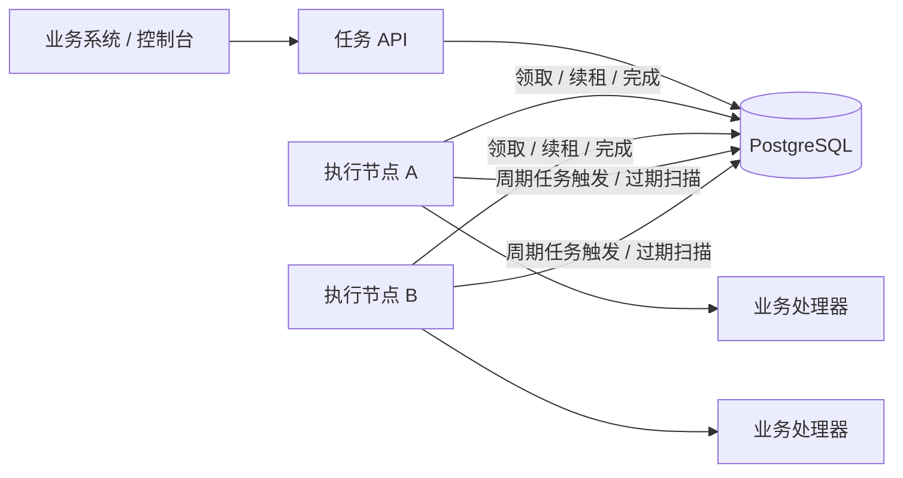
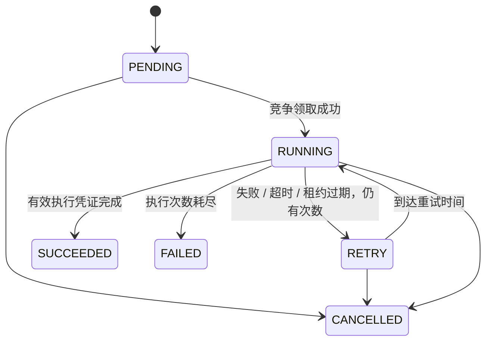

# 架构与一致性设计

## 组件

API 可以与执行节点合并部署，也可以通过 `WORKER_ENABLED=false` 独立部署。
节点主动领取任务，调度状态均在数据库中；本地内存只保存正在执行的任务与进度。
关系型数据库负责持久化和节点协调。本版本没有额外引入 Redis、MQ 或注册中心。

## 数据模型

- `forge_task`：业务参数、请求标识、状态、执行次数、租约、结果与进度。
- `forge_attempt`：一次任务的每次执行，主键 `(task_id, number)`。
- `forge_schedule`：Cron、时区、任务模板与下次触发时间。
- `forge_node`：节点角色、容量、活跃任务数与最后心跳，仅用于观测。

请求标识有唯一约束；原始计划时间独立保存，重试或完成后变更可执行时间不会破坏幂等判断。
JSON 参数按结构比较，其他业务参数必须一致。终态任务重放提交仍返回原任务。
数据库时间戳可能受精度影响，原始计划时间用字符串保存用于幂等比较。

## 任务状态机

`maxAttempts` 包含首次执行。每次成功领取递增一次；重试间隔为
`min(3600, retryDelaySeconds * 2^(attempts-1))` 秒，不在线程中睡眠等待重试。
终态不可重新开始；需要重新执行时，以新的请求标识提交新任务。

## 竞争领取

1. 按剩余执行容量查询到期任务，优先级降序、可执行时间升序。
2. 条件更新同时检查任务状态、执行次数、可执行时间与候选执行凭证。
3. 成功节点设置 owner，递增 token 和 attempts，设置租约。
4. 在同一事务中写入 RUNNING 执行记录，然后提交事务。
5. 事务提交后才运行处理器；业务执行期间不持有领取事务。

多个节点读到相同候选是正常情况，条件更新只允许一个节点获胜。
执行节点只有空闲槽位才领取任务，线程池和等待队列都有上限，不批量领取后无限堆积。
任务结束释放槽位后立即补充领取，定时轮询负责空闲节点唤醒，避免吞吐量被固定轮询周期限制。
大量节点可能反复竞争同一批候选，本版本没有做任务分片，因此不能假定增加节点会线性扩展。

## 心跳、接管与执行凭证

续租与完成均检查 `status=RUNNING`、owner、token，以及尚未过期的租约。
租约过期后，扫描节点条件更新任务为 RETRY 或 FAILED，并将执行记录标记为 LOST。
过期回收会递增 token，使旧节点即使恢复，也不能继续更新当前任务状态。

PostgreSQL 的领取、续租、完成与回收先取得任务行锁，再读取 `clock_timestamp()` 校验租约，
避免锁等待和事务开始时间造成过期凭证被接受。嵌入式 H2 与应用共享 JVM 时钟，直接读取当前时间。
多节点部署必须使用 PostgreSQL；H2 网络模式不受支持。执行超时使用本地单调时钟。
租约是失联恢复机制；业务超时是执行时间上限，两者独立。
续租失败的执行节点停止本地任务，数据库不可达时等待租约过期后由健康节点恢复。

这保证的是平台状态更新的有效性。节点可能在业务副作用发生后、成功状态写入前失联。
恢复节点因此可能再次执行同一业务，不能对任意处理器承诺 exactly-once。
处理器应使用稳定的任务或业务标识去重；若目标资源支持 fencing，则由目标资源校验凭证。

## 取消与超时

取消会锁定任务行、设置 CANCELLED、递增 token，并关闭正在运行的执行记录。
工作节点下次续租失败后发出线程中断；即使处理器继续运行，其结果也不能写回。
超时会先持久化失败或重试状态，再中断本地处理器。
忽略中断的处理器仍留在本地活跃集合中，防止执行容量统计提前释放而造成无限并发。
活跃集合按任务 ID 和执行凭证共同标识一次执行；同一任务的重试不会覆盖尚未退出的旧执行。
Java 线程无法安全地被强制终止，因此扩展处理器必须配置外部 I/O 超时并实现协作检查。

## 周期任务

Cron 使用 Spring `CronExpression`，支持六字段表达式和显式时区。
触发节点使用 `next_run` 条件更新竞争该触发时刻，在同一事务里推进调度并创建任务实例。
实例请求标识由调度 ID 和原计划时刻构成，额外提供唯一约束保护。
失败时整个事务回滚，防止只推进调度但没有创建任务。
暂停只影响未来触发；已生成的执行实例需要单独取消。

## 观测与运行

任务和执行记录是持久化事实；Prometheus 指标是进程内统计，重启会重置。
节点在线状态来自数据库心跳，10 秒没有心跳视为离线，不直接参与任务正确性决策。
执行日志包含任务 ID、次数、节点、结果类别，便于与任务记录关联。
默认不记录 API Key 或任务参数。

API 与 PostgreSQL 的通信失败会返回 503；提交方应使用相同 requestKey 重试。
数据库本身的高可用、备份和恢复由部署环境负责，本项目的多个执行节点不能替代数据库高可用。
